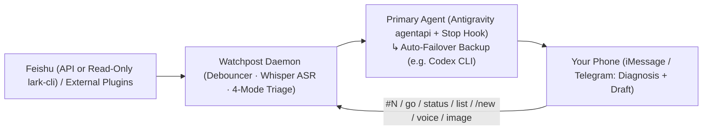

# Watchpost

**Headless local background bridge for your coding agent (`Apache-2.0`, `v0.3.0`).**
Watches selected chat channels, runs local triage + your coding agent (`Antigravity`, `Codex`, `Claude Code`, `Gemini CLI`, with automatic primary→backup failover), and delivers concise diagnoses and **1-tap-copy draft replies** strictly to your phone (`iMessage` or `Telegram`)—never auto-sending to external senders.

## How It Works



## Key Capabilities (`v0.3.0`)

- **Antigravity + Automatic Backup (`FallbackBackend`):** Native `AntigravityBackend` drives `agentapi` + `watchpost hook-stop` (via SQLite WAL completion polling), with transparent `FallbackBackend` failover to a backup preset such as read-only `codex` on start or steer failure.
- **Read-Only Feishu (`tenant`, `user`, `lark_cli`):** Official Feishu Open API or local read-only `lark-cli` with zero read-receipt leaks, `<at>` mention parsing, recall skipping, and resource downloads.
- **External Plugin Protocol (`ExternalCommandAdapter`):** Integrate external/copyleft chat bridges out-of-process over JSON stdin/stdout (`list-chats`, `fetch-recent`, `fetch-by-ids`, `download-media`).
- **Rich macOS iMessage & Phone Control:** Multi-handle `allowed_handles` matching, swipe-reply binding, `#N` / `#N go` list indexing, `/status`, `/list`, `/help`, `/new`, `/reset`, **Personal Direct Chat** with configurable workspace & TTL, plus iMessage audio (Whisper ASR) & image/file attachment forwarding.
- **Per-Channel Personas & Workspaces:** Load reusable channel prompts via `persona_file` and override `workspace_dir` per channel.
- **Interactive Sandbox & Headless Control API:** Built-in `sandbox-ui` (`http://127.0.0.1:8799`), terminal `sandbox`, and optional daemon-embedded localhost JSON API (`api_port`, zero Web UI).

## Quickstart

Requires Python `3.11+` and [`uv`](https://docs.astral.sh/uv/):

```bash
cd watchpost && uv sync --all-extras
```

### Option 1 — Guided Agent Skill (Recommended)
```bash
uv run watchpost install-skill --target claude   # or codex | antigravity
# Then ask your agent: "Set up Watchpost"
```

### Option 2 — Direct CLI Setup
```bash
uv run watchpost init-config                     # ~/.config/watchpost/config.json (0600)
export TELEGRAM_BOT_TOKEN="..."
uv run watchpost telegram-whoami                 # find your owner chat_id

uv run watchpost channels list-remote --adapter feishu
uv run watchpost channels add --adapter feishu --chat-id "oc_..." --name "Support" \
  --chat-type group --trigger mention_owner --autonomy diagnose_only --workspace ~/repo

uv run watchpost doctor && uv run watchpost run --once --seed
uv run watchpost run --api-port 8787
```

### Antigravity Stop Hook Integration
Wire `watchpost hook-stop` into your Antigravity `Stop` hook config so Watchpost collects turn outputs by `conversationId`:

```bash
uv run --project /path/to/watchpost watchpost hook-stop
```

### Interactive Sandbox, API & Tests
```bash
uv run watchpost sandbox-ui --backend mock       # 2-column browser simulator (IME-safe + debounce)
uv run watchpost sandbox-ui --backend codex --cwd /path/to/repo --autonomy diagnose_only
uv run watchpost sandbox --backend mock          # terminal REPL alternative
uv run watchpost demo                            # scripted offline simulation
uv run watchpost serve --host 127.0.0.1 --port 8787 --db ./data/watchpost.db
uv run pytest -v
```

> Use `sandbox-ui` (<http://127.0.0.1:8799>) to chat on the left as an outside colleague and reply/approve `"go"` on the right as your phone.

## Architecture, License & Roadmap

- **License boundary:** Core is `Apache-2.0` (official APIs and OS/CLI protocols only). Copyleft desktop bridges like `wechat-mcp` (`GPL-3.0`) stay separate out-of-process external plugin scripts invoked over JSON stdin/stdout—never imported into Watchpost.
- **Roadmap:** Phase 1 Core Engine (`v0.1.0`, Done) → Phase 2 Feishu + Telegram/iMessage + Skill (`v0.2.0`, Done) → Phase 3 Antigravity + Failover + External Plugin Protocol + Full iMessage Parity (`v0.3.0`, Done).
- Full architecture: [docs/ARCHITECTURE.md](docs/ARCHITECTURE.md) · License: [LICENSE](LICENSE)
