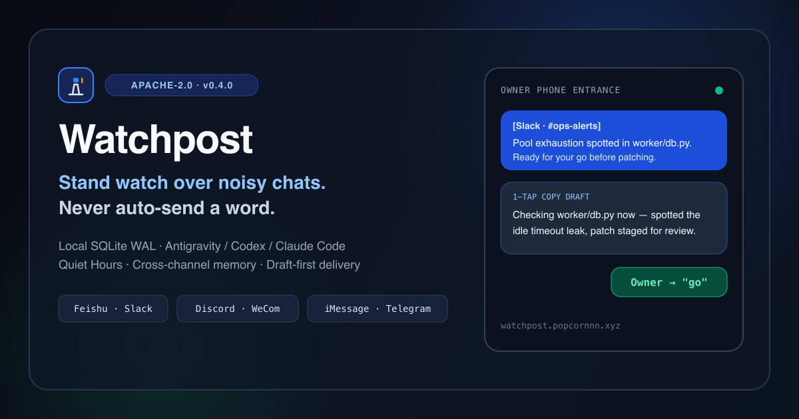
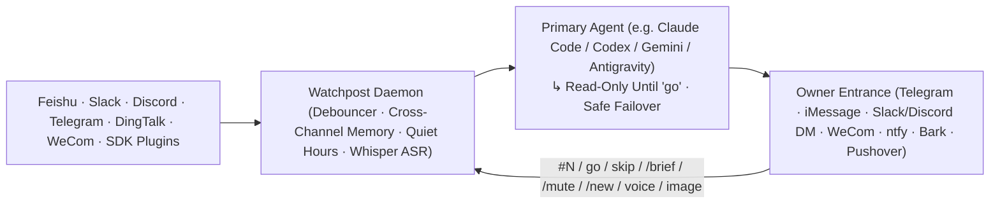

# Watchpost (`watchpost-agent`)

[](https://github.com/Popcornnnnnnnn/watchpost/actions/workflows/ci.yml)
[](https://github.com/Popcornnnnnnnn/watchpost/releases/latest)
[](https://github.com/Popcornnnnnnnn/watchpost/blob/main/LICENSE)
[](https://www.python.org/downloads/)
[](https://watchpost.popcornnn.xyz)

**English** · [简体中文](README.zh-CN.md)

**Website:** [watchpost.popcornnn.xyz](https://watchpost.popcornnn.xyz)

**Headless local background bridge for your coding agent (`Apache-2.0`).**
Watches selected chat channels, runs local triage + your coding agent (`Antigravity`, `Codex`, `Claude Code`, `Gemini CLI`, with automatic primary→backup failover), and delivers concise diagnoses and **1-tap-copy draft replies** strictly to your phone or DM—never auto-sending to external senders.



## How It Works



## Key Capabilities

- **Draft-First 4-Mode Triage & Strict `"go"` Approval Gate:** Distinguishes quick Q&A/advice/FYIs from real bugs, diagnoses safely (`assistant_only`, `diagnose_only`, `auto_fix`), and requires explicit approval (`go` / `approve` / `执行` / `批准`, or `skip` to dismiss) while holding a pending proposal before touching code.
- **Per-Channel CLI Sandbox Enforcement:** Enforces read-only/plan flags during diagnosis and only enables file-editing flags for verified `approved_go` turns or explicit `auto_fix` channels:

| Backend | Read-Only (`assistant_only` / `diagnose_only`) | Writable (`approved_go` / `auto_fix`) | Timeout Cleanup |
| --- | --- | --- | --- |
| `codex` | `--sandbox read-only` (start) / `-c sandbox_mode="read-only"` (resume) | `--sandbox workspace-write` / `-c sandbox_mode="workspace-write"` | `kill_process_tree` (`SIGKILL` process group) |
| `claude_code` | `--permission-mode plan` | `--permission-mode acceptEdits` | `kill_process_tree` (`SIGKILL` process group) |
| `gemini_cli` | `--approval-mode plan` | `--approval-mode auto_edit` | `kill_process_tree` (`SIGKILL` process group) |
| `antigravity` | Local `agentapi` turn + Stop Hook | `agentapi` turn + Stop Hook | `kill_process_tree` (`SIGKILL` process group) |

- **Quiet Hours + Morning Briefing:** Suppress notifications during configured overnight hours (for example `23:00–08:00`) while silently diagnosing incoming messages and flushing one clean morning briefing (`auto_brief_on_end`), plus `/brief`, `/mute 2h`, `/unmute`, and urgent keyword breakthrough.
- **Cross-Channel "Same Incident" Memory & Prompt Fencing:** Feeds recent incident digests from sibling channels sharing a workspace while wrapping untrusted external chat inputs, reply previews, and memory entries in randomized per-prompt `<untrusted_chat_data_{nonce}>` fences.
- **Hardened Control API & Isolated `webhook_port`:** Local control routes on `--api-port 8787` enforce a `0o600` Bearer token (`~/.local/share/watchpost/api.token`), loopback `Host` allowlist, and browser `Origin` blocking. Expose an optional separate `webhook_port` (e.g., `8788`) for public reverse tunnels so `/api/*` control routes stay local-only.
- **10 Native Integrations + Out-of-Process Plugin SDK:** Built-in support for **Feishu / Lark**, **Slack**, **Discord**, **Telegram** (outbound + shared-hub inbound), **DingTalk**, **WeCom (企业微信)**, **macOS iMessage**, **ntfy**, **Bark**, and **Pushover**, plus a clean-room WhatsApp stdio SDK template ([`examples/whatsapp_plugin_template.py`](https://github.com/Popcornnnnnnnn/watchpost/blob/main/examples/whatsapp_plugin_template.py)).
- **Background Service & Reliability Controls:** Single-instance `watchpost.lock`, token-scoped Telegram polling with `409`/`429` backoff, secret redaction across logs/HTTP errors, periodic media pruning, and `watchpost service install|status|uninstall` (`launchd` / `systemd --user`).

## Quickstart (5-Minute Onboarding)

Requires Python `3.11+`:

```bash
# Recommended: install CLI globally from GitHub via uv or pipx
uv tool install git+https://github.com/Popcornnnnnnnn/watchpost.git
# or: pipx install git+https://github.com/Popcornnnnnnnn/watchpost.git

# Or install from source
git clone https://github.com/Popcornnnnnnnn/watchpost.git && cd watchpost
uv sync --all-extras
```

### 1. Guided Setup & `.env` Credentials
```bash
# Writes 0600 ~/.config/watchpost/config.json (with optional 0600 ~/.config/watchpost/.env)
watchpost setup

# Pair Telegram bot with nonce-verified private /start link (uploads avatar + / commands)
watchpost telegram-setup --token "$TELEGRAM_BOT_TOKEN" --test-message
# Or inspect recent chat IDs manually:
watchpost telegram-whoami
```

### 2. Enroll Channels & Verify
```bash
watchpost channels list-remote --adapter feishu
watchpost channels add --adapter feishu --chat-id "oc_..." --name "Support" \
  --chat-type group --trigger mention_owner --autonomy diagnose_only --workspace ~/repo
watchpost channels list
watchpost channels remove --id <channel_id>

watchpost doctor --live
watchpost run --once --seed
```

### 3. Run Continuously or Install Background Service
```bash
# Foreground daemon
watchpost run --api-port 8787

# Or install launchd (macOS) / systemd --user (Linux) auto-start unit
watchpost service install --print-only   # preview plist/service unit
watchpost service install
watchpost service status
watchpost service uninstall
```

*(Note on WeCom: `/api/webhooks/wecom` verifies SHA1 `msg_signature` and expects plaintext XML or JSON payloads, or traffic forwarded behind an upstream AES decryption proxy.)*

### Guided Agent Skill
```bash
watchpost install-skill --target claude   # or codex | antigravity
```

### Control API Authentication
Local `/api/*` endpoints on `api_port` require the auto-generated `0o600` token next to your SQLite DB (`~/.local/share/watchpost/api.token`):
```bash
TOKEN="$(cat ~/.local/share/watchpost/api.token)"
curl -s -X POST -H "Authorization: Bearer $TOKEN" http://127.0.0.1:8787/api/reload
```

### Plugin SDK Quickstart (`ChannelPlugin` & `NotifierPlugin`)
```bash
watchpost plugins scaffold --kind channel --name my_bridge --dest ./plugins/my_bridge
watchpost plugins check --kind channel --test-fetch --cmd python3 ./plugins/my_bridge/plugin.py

# Reference templates (Channel, Notifier, and WhatsApp bridge):
watchpost plugins check --kind channel --test-fetch --cmd python3 examples/channel_plugin_template.py
watchpost plugins check --kind channel --test-fetch --cmd python3 examples/whatsapp_plugin_template.py
watchpost plugins check --kind notifier --cmd python3 examples/notifier_plugin_template.py
```

### Antigravity Stop Hook Integration
```bash
uv run --project /path/to/watchpost watchpost hook-stop
```

### Interactive Sandbox, API & Tests
```bash
watchpost sandbox-ui --backend mock       # 2-column browser simulator (IME-safe + debounce)
watchpost sandbox-ui --backend codex --cwd /path/to/repo --autonomy diagnose_only
watchpost sandbox --backend mock          # terminal REPL alternative
watchpost demo                            # scripted offline simulation
watchpost serve --host 127.0.0.1 --port 8787 --db ./data/watchpost.db
uv run pytest -q
```

> Use `sandbox-ui` (`http://127.0.0.1:8799`) to chat on the left as an outside colleague and reply/approve `"go"` on the right as your phone.

## Architecture, License & Roadmap

- **License boundary:** Core is `Apache-2.0` (official APIs and OS/CLI protocols only). Copyleft desktop bridges such as `wechat-mcp` (`GPL-3.0`) stay separate out-of-process external plugin scripts invoked over JSON stdin/stdout—never imported into Watchpost.
- **Full docs:** [Architecture](https://github.com/Popcornnnnnnnn/watchpost/blob/main/docs/ARCHITECTURE.md) · [Plugin SDK](https://github.com/Popcornnnnnnnn/watchpost/blob/main/docs/PLUGIN_SDK.md) · [Platform Roadmap](https://github.com/Popcornnnnnnnn/watchpost/blob/main/docs/PLATFORM_ROADMAP.md) · [Security Policy](https://github.com/Popcornnnnnnnn/watchpost/blob/main/SECURITY.md) · [Changelog](https://github.com/Popcornnnnnnnn/watchpost/blob/main/CHANGELOG.md) · [License](https://github.com/Popcornnnnnnnn/watchpost/blob/main/LICENSE)
