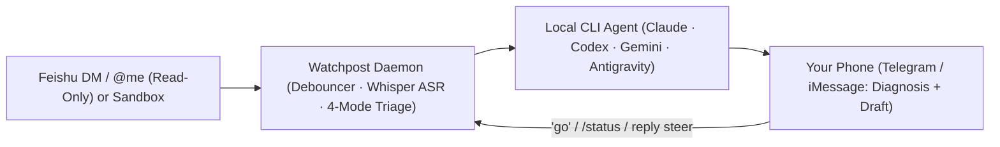

# Watchpost

**Headless local background bridge for your coding agent (`Apache-2.0`, `v0.2.0`).**
Watches selected chat channels, runs local triage + your own CLI coding agent (`Claude Code`, `Codex`, `Gemini CLI`, `Antigravity`), and delivers concise diagnoses and **1-tap-copy draft replies** strictly to your phone (`Telegram` or macOS `iMessage`)—never auto-sending to external senders.

## How It Works



## Key Capabilities (`v0.2.0`)

- **Zero copy-paste bottleneck:** Starts debugging or drafting immediately while keeping private repos and credentials on your machine.
- **Read-only Feishu adapter:** Polls DMs/groups with zero read-receipt leaks, handles media/voice/recalls, and discovers chats (`watchpost channels list-remote`).
- **Phone-only handoff:** Owner-locked Telegram bot or macOS iMessage (`~/Library/Messages/chat.db`) with `"go"` approval, `/status`, `/list`, and reply steering.
- **2-bucket context & Whisper ASR:** Separates linked clues/media from chatter, transcribes audio locally, and triages across 4 modes under `assistant_only`, `diagnose_only`, or `auto_fix`.
- **Guided Agent Skill:** Install directly into Claude Code, Codex, or Antigravity via `watchpost install-skill`.

## Quickstart

Requires Python `3.11+` and [`uv`](https://docs.astral.sh/uv/):

```bash
cd watchpost && uv sync --all-extras
```

### Option 1 — Guided Agent Skill (Recommended)
```bash
uv run watchpost install-skill --target claude   # or codex | antigravity
# Then ask your agent: "Set up Watchpost"
```

### Option 2 — Direct CLI Setup
```bash
uv run watchpost init-config                     # ~/.config/watchpost/config.json (0600)
export TELEGRAM_BOT_TOKEN="..."
uv run watchpost telegram-whoami                 # find your owner chat_id

export FEISHU_APP_ID="..." FEISHU_APP_SECRET="..." FEISHU_OWNER_OPEN_ID="ou_..."
uv run watchpost channels list-remote --adapter feishu
uv run watchpost channels add --adapter feishu --chat-id "oc_..." --name "Support" \
  --chat-type group --trigger mention_owner --autonomy diagnose_only

uv run watchpost doctor && uv run watchpost run --once --seed
uv run watchpost run
```

### Interactive Sandbox, API & Tests
```bash
uv run watchpost sandbox --backend mock          # offline interactive loop (zero token cost)
uv run watchpost sandbox --backend codex --cwd /path/to/repo
uv run watchpost demo                            # scripted offline simulation
uv run watchpost serve --host 127.0.0.1 --port 8787 --db ./data/watchpost.db
uv run pytest -v
```

> In `sandbox`, type messages as a colleague or use `/mode group`, `/as Boss`, `/at`, `/reply`, `/img`, `/recall`, `/autonomy`, and `/phone go|status|<steer>`.

## Architecture, License & Roadmap

- **License boundary:** Core is `Apache-2.0` (official APIs only). Copyleft desktop bridges like [`wechat-mcp`](https://github.com/Popcornnnnnnnn/wechat-mcp) (`GPL-3.0`) stay separate out-of-process services over local HTTP (`:8300`) or CLI.
- **Roadmap:** Phase 1 Core Engine (`v0.1.0`, Done) → Phase 2 Feishu + Telegram/iMessage + Skill (`v0.2.0`, Done) → Phase 3 Slack Socket Mode, auto-persona, digest mode, Docker (Planned).
- Full architecture: [docs/ARCHITECTURE.md](docs/ARCHITECTURE.md) · License: [LICENSE](LICENSE)
