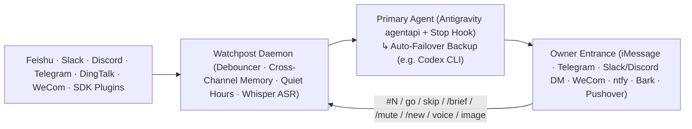

# Watchpost

**Website:** [watchpost.popcornnn.xyz](https://watchpost.popcornnn.xyz)

**Headless local background bridge for your coding agent (`Apache-2.0`).**
Watches selected chat channels, runs local triage + your coding agent (`Antigravity`, `Codex`, `Claude Code`, `Gemini CLI`, with automatic primary→backup failover), and delivers concise diagnoses and **1-tap-copy draft replies** strictly to your phone or DM—never auto-sending to external senders.

## How It Works



## Key Capabilities

- **Draft-First 4-Mode Triage & `"go"` Approval Gate:** Distinguishes quick Q&A/advice/FYIs from real bugs, diagnoses safely (`assistant_only`, `diagnose_only`, `auto_fix`), and waits for your explicit `"go"` (or `skip` to dismiss) before touching production code or configs.
- **Quiet Hours + Morning Briefing:** Suppress notifications during configured overnight hours (for example `23:00–08:00`) while silently diagnosing incoming messages and flushing one clean morning briefing (`auto_brief_on_end`), plus `/brief`, `/mute 2h`, `/unmute`, and urgent keyword breakthrough.
- **Cross-Channel "Same Incident" Memory:** Feeds a compact recent-incidents digest from sibling channels sharing the same workspace into new threads while isolating personal direct chats.
- **Zero-Downtime Hot Reload:** Reload channels, personas, Quiet Hours, and debounce settings in milliseconds via `POST /api/reload` or `SIGHUP`, and persist per-channel autonomy changes via `PATCH /api/channels/{id}`.
- **Native Backends + Automatic Backup (`FallbackBackend`):** First-class `AntigravityBackend` (`agentapi` + `watchpost hook-stop`), `codex`, `claude_code`, and `gemini_cli`.
- **Multi-Platform Work Sources & Owner Entrances:** Native built-in support for **Feishu / Lark**, **Slack**, **Discord**, **Telegram** (outbound + shared-hub inbound), **DingTalk**, **WeCom (企业微信)**, **macOS iMessage**, **ntfy** (1-way + 2-way `reply_topic`), **Bark** (1-tap `copy` draft), and **Pushover**, plus a clean-room WhatsApp stdio SDK template (`examples/whatsapp_plugin_template.py`).
- **Extensible Channel & Notifier Plugin SDK (`watchpost.sdk`):** Connect custom internal tools or external desktop bridges via `external_adapters` & `external_notifiers`, scaffold with `watchpost plugins scaffold`, and validate with `watchpost plugins check`.
- **Rich Phone Control & Built-In Sandbox:** Swipe-reply routing, `#N` indexing, **Personal Direct Chat** (`/new`, `/reset`), voice/photo handling, plus interactive `sandbox-ui` (`http://127.0.0.1:8799`).

## Quickstart

Requires Python `3.11+` and [`uv`](https://docs.astral.sh/uv/):

```bash
cd watchpost && uv sync --all-extras
```

### Option 1 — Interactive Setup Wizard (Recommended)
```bash
uv run watchpost setup                           # guided wizard -> ~/.config/watchpost/config.json (0600)
# Export your chosen env vars (e.g. FEISHU_OWNER_OPEN_ID, TELEGRAM_BOT_TOKEN, WATCHPOST_IMESSAGE_HANDLE)
uv run watchpost channels list-remote --adapter feishu
uv run watchpost channels add --adapter feishu --chat-id "oc_..." --name "Support" \
  --chat-type group --trigger mention_owner --autonomy diagnose_only --workspace ~/repo

uv run watchpost doctor && uv run watchpost run --once --seed
uv run watchpost run --api-port 8787
```

*(Scripted CI / headless setup is also supported via `watchpost setup --non-interactive --backend codex ...` or `watchpost init-config`.)*

### Option 2 — Guided Agent Skill
```bash
uv run watchpost install-skill --target claude   # or codex | antigravity
```

### Plugin SDK Quickstart (`ChannelPlugin` & `NotifierPlugin`)
```bash
uv run watchpost plugins scaffold --kind channel --name my_bridge --dest ./plugins/my_bridge
uv run watchpost plugins check --kind channel --test-fetch --cmd python3 ./plugins/my_bridge/plugin.py

# Or test the included reference templates (Channel, Notifier, and WhatsApp bridge):
uv run watchpost plugins check --kind channel --test-fetch --cmd python3 examples/channel_plugin_template.py
uv run watchpost plugins check --kind channel --test-fetch --cmd python3 examples/whatsapp_plugin_template.py
uv run watchpost plugins check --kind notifier --cmd python3 examples/notifier_plugin_template.py
```

See [docs/PLUGIN_SDK.md](docs/PLUGIN_SDK.md) for the full Python SDK and stdio JSON contract, and [docs/PLATFORM_ROADMAP.md](docs/PLATFORM_ROADMAP.md) for upcoming first-class platforms.

### Antigravity Stop Hook Integration
Wire `watchpost hook-stop` into your Antigravity `Stop` hook config so Watchpost collects turn outputs by `conversationId`:

```bash
uv run --project /path/to/watchpost watchpost hook-stop
```

### Interactive Sandbox, API & Tests
```bash
uv run watchpost sandbox-ui --backend mock       # 2-column browser simulator (IME-safe + debounce)
uv run watchpost sandbox-ui --backend codex --cwd /path/to/repo --autonomy diagnose_only
uv run watchpost sandbox --backend mock          # terminal REPL alternative
uv run watchpost demo                            # scripted offline simulation
uv run watchpost serve --host 127.0.0.1 --port 8787 --db ./data/watchpost.db
uv run pytest -v
```

> Use `sandbox-ui` (<http://127.0.0.1:8799>) to chat on the left as an outside colleague and reply/approve `"go"` on the right as your phone.

## Architecture, License & Roadmap

- **License boundary:** Core is `Apache-2.0` (official APIs and OS/CLI protocols only). Copyleft desktop bridges such as `wechat-mcp` (`GPL-3.0`) stay separate out-of-process external plugin scripts invoked over JSON stdin/stdout—never imported into Watchpost.
- **Full docs:** [docs/ARCHITECTURE.md](docs/ARCHITECTURE.md) · [docs/PLUGIN_SDK.md](docs/PLUGIN_SDK.md) · [docs/PLATFORM_ROADMAP.md](docs/PLATFORM_ROADMAP.md) · License: [LICENSE](LICENSE)
