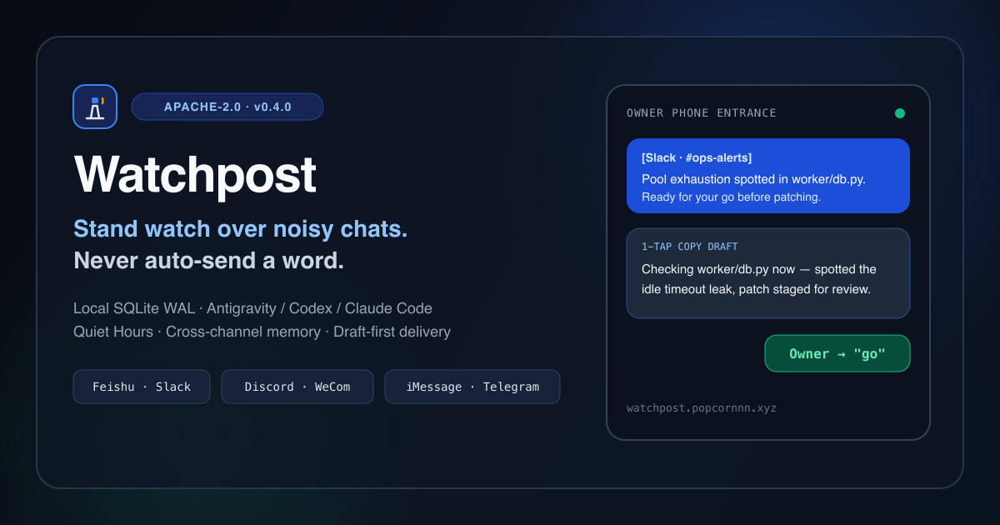
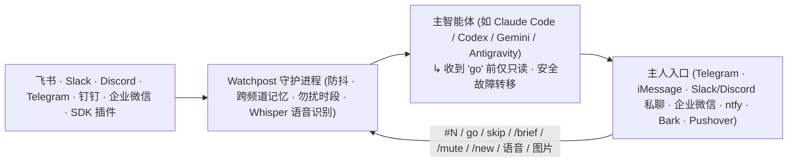

# Watchpost (`watchpost-agent`)

[](https://github.com/Popcornnnnnnnn/watchpost/actions/workflows/ci.yml)
[](https://github.com/Popcornnnnnnnn/watchpost/releases/latest)
[](https://github.com/Popcornnnnnnnn/watchpost/blob/main/LICENSE)
[](https://www.python.org/downloads/)
[](https://watchpost.popcornnn.xyz)

[English](README.md) · **简体中文**

**网站：** [watchpost.popcornnn.xyz](https://watchpost.popcornnn.xyz)

**面向编程智能体的无界面本地后台桥接器（`Apache-2.0`）。**
持续监听指定聊天频道，运行本地分诊与你的编程智能体（`Antigravity`、`Codex`、`Claude Code`、`Gemini CLI`，支持主备自动故障转移），并将精简的诊断结果与**一键复制回复草稿**严格发送到你的手机或私聊中——绝不自动向外部发送方回复。



## 工作原理



## 核心能力

- **草稿优先的四模式分诊与严格 `"go"` 审批门控：** 区分轻量问答/建议/知会与真实缺陷，安全地执行诊断（`assistant_only`、`diagnose_only`、`auto_fix`），并在持有待处理提案时要求显式批准（`go` / `approve` / `执行` / `批准`，或发送 `skip` 忽略）后才会修改代码。
- **按频道强制执行 CLI 沙箱：** 在诊断阶段强制启用只读/规划参数，仅在经过核验的 `approved_go` 轮次或显式配置的 `auto_fix` 频道中开启文件编辑权限：

| 后端 | 只读模式（`assistant_only` / `diagnose_only`） | 可写模式（`approved_go` / `auto_fix`） | 超时清理 |
| --- | --- | --- | --- |
| `codex` | `--sandbox read-only`（新会话）/ `-c sandbox_mode="read-only"`（恢复） | `--sandbox workspace-write` / `-c sandbox_mode="workspace-write"` | `kill_process_tree`（`SIGKILL` 进程组） |
| `claude_code` | `--permission-mode plan` | `--permission-mode acceptEdits` | `kill_process_tree`（`SIGKILL` 进程组） |
| `gemini_cli` | `--approval-mode plan` | `--approval-mode auto_edit` | `kill_process_tree`（`SIGKILL` 进程组） |
| `antigravity` | 本地 `agentapi` 轮次 + Stop Hook | `agentapi` 轮次 + Stop Hook | `kill_process_tree`（`SIGKILL` 进程组） |

- **勿扰时段与晨间简报：** 在配置的夜间时段（例如 `23:00–08:00`）静默抑制通知，同时后台静默诊断收到的消息，并在时段结束时统一发送一份干净的晨间简报（`auto_brief_on_end`），此外支持 `/brief`、`/mute 2h`、`/unmute` 以及紧急关键词突破。
- **跨频道“同一事件”记忆与提示词隔离围栏：** 为共享同一工作区的兄弟频道注入近期事件摘要，同时用随机生成、按次隔离的 `<untrusted_chat_data_{nonce}>` 围栏包裹外部非信任聊天输入、回复预览与记忆条目。
- **加固的控制 API 与隔离的 `webhook_port`：** `--api-port 8787` 上的本地控制路由强制校验 `0o600` Bearer 令牌（`~/.local/share/watchpost/api.token`）、回环 `Host` 白名单并拦截浏览器 `Origin`。如需暴露公网反向隧道，可单独开启 `webhook_port`（例如 `8788`），使 `/api/*` 控制路由始终仅限本地访问。
- **10 种原生集成 + 进程外插件 SDK：** 内置支持 **飞书 / Lark**、**Slack**、**Discord**、**Telegram**（出站与共享中心入站）、**钉钉**、**企业微信**、**macOS iMessage**、**ntfy**、**Bark** 与 **Pushover**，并附带洁净室编写的 WhatsApp stdio SDK 模板（[`examples/whatsapp_plugin_template.py`](https://github.com/Popcornnnnnnnn/watchpost/blob/main/examples/whatsapp_plugin_template.py)）。
- **后台服务与可靠性控制：** 单实例 `watchpost.lock`、按令牌隔离的 Telegram 轮询（带 `409`/`429` 退避）、日志与 HTTP 错误中的密钥脱敏、定期媒体文件清理，以及 `watchpost service install|status|uninstall`（`launchd` / `systemd --user`）。

## 快速开始（5 分钟上手）

需要 Python `3.11+`：

```bash
# 推荐：通过 uv 或 pipx 从 GitHub 全局安装 CLI
uv tool install git+https://github.com/Popcornnnnnnnn/watchpost.git
# 或者：pipx install git+https://github.com/Popcornnnnnnnn/watchpost.git

# 或从源码安装
git clone https://github.com/Popcornnnnnnnn/watchpost.git && cd watchpost
uv sync --all-extras
```

### 1. 引导式配置与 `.env` 凭据
```bash
# 写入权限为 0600 的 ~/.config/watchpost/config.json（以及可选的 0600 ~/.config/watchpost/.env）
watchpost setup

# 通过带 nonce 校验的私聊 /start 链接配对 Telegram 机器人（自动上传头像与 / 命令菜单）
watchpost telegram-setup --token "$TELEGRAM_BOT_TOKEN" --test-message
# 或手动查看最近的聊天 ID：
watchpost telegram-whoami
```

### 2. 注册频道并验证
```bash
watchpost channels list-remote --adapter feishu
watchpost channels add --adapter feishu --chat-id "oc_..." --name "Support" \
  --chat-type group --trigger mention_owner --autonomy diagnose_only --workspace ~/repo
watchpost channels list
watchpost channels remove --id <channel_id>

watchpost doctor --live
watchpost run --once --seed
```

### 3. 持续运行或安装为后台服务
```bash
# 前台守护进程
watchpost run --api-port 8787

# 或安装 launchd (macOS) / systemd --user (Linux) 自启动单元
watchpost service install --print-only   # 预览 plist/service 配置
watchpost service install
watchpost service status
watchpost service uninstall
```

*（企业微信说明：`/api/webhooks/wecom` 会校验 SHA1 `msg_signature`，期望接收明文 XML 或 JSON 负载，或经上游 AES 解密代理转发后的流量。）*

### 引导式智能体技能
```bash
watchpost install-skill --target claude   # 或 codex | antigravity
```

### 控制 API 认证
`api_port` 上的本地 `/api/*` 接口需要自动生成在 SQLite 数据库旁的 `0o600` 令牌（`~/.local/share/watchpost/api.token`）：
```bash
TOKEN="$(cat ~/.local/share/watchpost/api.token)"
curl -s -X POST -H "Authorization: Bearer $TOKEN" http://127.0.0.1:8787/api/reload
```

### 插件 SDK 快速开始（`ChannelPlugin` 与 `NotifierPlugin`）
```bash
watchpost plugins scaffold --kind channel --name my_bridge --dest ./plugins/my_bridge
watchpost plugins check --kind channel --test-fetch --cmd python3 ./plugins/my_bridge/plugin.py

# 参考模板（Channel、Notifier 与 WhatsApp 桥接）：
watchpost plugins check --kind channel --test-fetch --cmd python3 examples/channel_plugin_template.py
watchpost plugins check --kind channel --test-fetch --cmd python3 examples/whatsapp_plugin_template.py
watchpost plugins check --kind notifier --cmd python3 examples/notifier_plugin_template.py
```

### Antigravity Stop Hook 集成
```bash
uv run --project /path/to/watchpost watchpost hook-stop
```

### 交互式沙箱、API 与测试
```bash
watchpost sandbox-ui --backend mock       # 双栏浏览器模拟器（输入法安全 + 防抖）
watchpost sandbox-ui --backend codex --cwd /path/to/repo --autonomy diagnose_only
watchpost sandbox --backend mock          # 终端 REPL 替代方案
watchpost demo                            # 脚本化离线模拟
watchpost serve --host 127.0.0.1 --port 8787 --db ./data/watchpost.db
uv run pytest -q
```

> 打开 `sandbox-ui`（`http://127.0.0.1:8799`）可在左侧以外部同事身份发消息，在右侧以你的手机身份回复或批准 `"go"`。

## 架构、许可证与路线图

- **许可证边界：** 核心采用 `Apache-2.0`（仅使用官方 API 与操作系统/CLI 协议）。诸如 `wechat-mcp`（`GPL-3.0`）等强传染性桌面桥接工具始终作为独立进程的外部插件脚本通过 JSON stdin/stdout 调用——绝不会直接导入 Watchpost。
- **完整文档：** [架构说明](https://github.com/Popcornnnnnnnn/watchpost/blob/main/docs/ARCHITECTURE.md) · [插件 SDK](https://github.com/Popcornnnnnnnn/watchpost/blob/main/docs/PLUGIN_SDK.md) · [平台路线图](https://github.com/Popcornnnnnnnn/watchpost/blob/main/docs/PLATFORM_ROADMAP.md) · [安全策略](https://github.com/Popcornnnnnnnn/watchpost/blob/main/SECURITY.md) · [更新日志](https://github.com/Popcornnnnnnnn/watchpost/blob/main/CHANGELOG.md) · [许可证](https://github.com/Popcornnnnnnnn/watchpost/blob/main/LICENSE)
