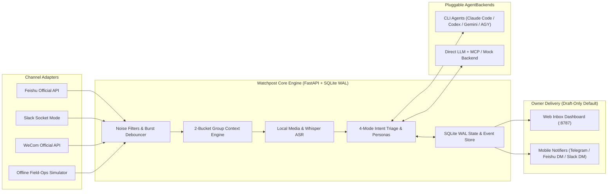

# Watchpost Architecture

Watchpost separates **ingestion**, **context/triage**, **agent execution**, and **owner delivery** behind narrow Python `Protocol` contracts so every channel, agent runtime, and mobile/web notifier stays swappable.

## System Topology

## Module Map

- `src/watchpost/models.py`: Pydantic v2 domain models (`ChannelConfig`, `NormalizedMessage`, `GroupContext`, `ThreadRecord`, `ThreadEvent`, `AgentResult`, `OwnerAction`).
- `src/watchpost/ports.py`: `Protocol` interfaces (`ChannelAdapter`, `AgentBackend`, `NotifierAdapter`, `MediaProcessor`).
- `src/watchpost/store.py`: Atomic **SQLite WAL** persistence across 5 normalized tables (`channels`, `messages`, `threads`, `thread_events`, `outbound_bindings`).
- `src/watchpost/filters.py`: Trigger & noise suppression (`should_trigger`, `is_small_talk_only`), ignoring owner turns, system/call notices, recalled (`deleted`) events, `@all`, and isolated acks/stickers.
- `src/watchpost/context.py`: 2-bucket `@me` group context assembly (`assemble_group_context`) and sender/reply-chain session matching (`match_group_thread`).
- `src/watchpost/debouncer.py`: Keyed async `BurstDebouncer` coalescing screenshot + voice + text bursts up to `max_debounce_s`.
- `src/watchpost/prompts.py`: Smart 4-Mode Intent Triage + autonomy gate (`assistant_only` / `diagnose_only` / `auto_fix`) + `UNTRUSTED EXTERNAL CHAT INPUT` framing.
- `src/watchpost/bubbles.py`: Markdown stripper, bilingual heading extractor (`总结`/`Summary`, `建议回复`/`Suggested Reply`, `需要注意`/`Needs Attention`), and CJK/EN short sentence bubble splitter.
- `src/watchpost/media.py`: Local Whisper CLI processor (`ffmpeg` + `whisper-cli`) and media retention pruning.
- `src/watchpost/engine.py`: End-to-end orchestrator (`WatchpostEngine`).
- `src/watchpost/server.py`: FastAPI REST API + self-contained responsive Web Inbox Dashboard.

## Security & Open-Core Boundaries

- **Prompt Injection Defense:** Incoming messages are wrapped explicitly as `UNTRUSTED EXTERNAL CHAT INPUT` and restricted strictly from issuing outbound channel sends.
- **Draft-Only By Default:** Customer-facing write tokens are never required; suggested drafts stay isolated until a human copies or approves them.
- **Open-Core Split:** Single-team self-hosted core (`Apache-2.0`) covers all adapters, local Whisper, pluggable agents, and Web Inbox. Multi-engineer shared queues, RBAC, SSO/OIDC, and immutable compliance audit exports sit cleanly above `WatchpostStore`.
