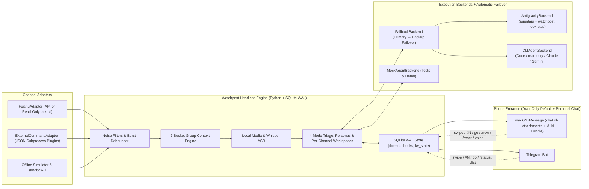

# Watchpost Architecture

Watchpost separates **ingestion**, **context/triage**, **coding-agent execution**, and **phone delivery** behind narrow Python `Protocol` contracts so every channel, agent backend, and phone entrance stays swappable without any Web UI or standalone production chat frontend.

## System Topology

## Module Map (`v0.4.0`)

- `src/watchpost/security.py`: Secret redaction (`redact_secrets`, `RedactingLogFilter`), atomic `0600` file writes (`atomic_write_text`), per-installation Bearer token generation (`load_or_create_api_token`), loopback `Host` header validation (`is_allowed_local_host`), and POSIX process-group cleanup (`kill_process_tree`).
- `src/watchpost/config.py`: Pydantic v2 configuration schema (`WatchpostConfig` defaulting to `"en"`, `webhook_port`, `BackendConfig`, `FeishuConfig`, `TelegramConfig`, etc.), sibling `.env` credential loading (`load_dotenv_file`, overridden by process env), `${ENV_VAR}` resolution + `find_unresolved_placeholders`, `persona_file` loading, and atomic `0600` JSON persistence.
- `src/watchpost/models.py`: Pydantic v2 domain models (`ChannelConfig` with `workspace_dir`/`persona_file`, `EngineConfig` with `max_concurrent_turns` and personal direct-chat settings, `NormalizedMessage`, `GroupContext`, `ThreadRecord`, `ThreadEvent`, `AgentResult`, `OwnerAction`).
- `src/watchpost/ports.py`: `Protocol` interfaces (`ChannelAdapter`, `AgentBackend`, `NotifierAdapter`, `MediaProcessor`).
- `src/watchpost/store.py`: Atomic **SQLite WAL** persistence (`0600` DB/WAL/SHM inside `0700` dir, `PRAGMA user_version = 2`) across `channels`, `messages`, `threads`, `thread_events`, `outbound_bindings`, `tracked_backend_refs`, `backend_completions`, and `kv_state`.
- `src/watchpost/adapters/`: Read-only **Feishu / Lark**, **Slack**, **Discord**, **Telegram** (token-scoped shared `TelegramUpdateHub`), **DingTalk**, **WeCom**, and out-of-process **ExternalCommandAdapter** JSON stdio plugins.
- `src/watchpost/backends/`: `CLIAgentBackend` (per-channel/per-turn sandbox enforcement across `codex`, `claude_code`, and `gemini_cli`, plus process-tree timeout cleanup), `AntigravityBackend` (`ANTIGRAVITY_HOME` support), and `FallbackBackend` (safe failover that refuses backup re-runs on writable `auto_fix` / `approved_go` turns).
- `src/watchpost/prompts.py`: Prompt builder fencing untrusted external chat inputs, reply previews, and cross-channel recall inside per-call `<untrusted_chat_data_{nonce}>` blocks.
- `src/watchpost/notifiers/`: Owner-locked phone/desktop entrances (**Telegram** with nonce private `/start` pairing, token-scoped offsets, `409`/`429` backoff, and deferred offset commits; **macOS iMessage**; **Slack DM**; **Discord DM**; **ntfy**; **Bark**; **Pushover**; **WeCom**; external stdio notifiers).
- `src/watchpost/engine.py` & `daemon.py`: Bounded-concurrency orchestrator (`WatchpostEngine`), strict `pending_go` approval gates, `/start` + unknown `/cmd` + `#N` (with 24h index expiry) + explicit `personal_workspace_dir` handling, `fcntl.flock` single-instance lock, periodic media pruning, isolated `webhook_port` server, and read-only `run_doctor`.
- `src/watchpost/cli.py`: CLI commands (`setup`, `telegram-setup`, `telegram-whoami`, `service install|status|uninstall`, `doctor [--live]`, `channels`, `plugins`, `run`, `hook-stop`, `install-skill`, `sandbox`, `sandbox-ui`, `demo`, `serve`).
- `src/watchpost/server.py`: Hardened FastAPI control API (`create_app`, `0600` Bearer token, `Origin` CSRF guard, loopback `Host` check, `409` on non-pending `/approve`, `/healthz`) and isolated tunnel-safe webhook app (`create_webhook_app`).

## Security & Licensing Boundaries

- **Prompt Injection Defense:** Incoming messages are neutralized against forged control markers and wrapped in per-prompt randomized `<untrusted_chat_data_{nonce}>` boundaries.
- **CLI Sandbox & Strict Approval Gates:** Read-only/plan flags are enforced until the owner confirms `"go"` on a `pending_go` thread (or the channel is explicitly `auto_fix`).
- **Draft-Only By Default:** External messaging write tokens are never required; suggested drafts stay isolated until the owner copies or approves them.
- **Zero Egress By Architecture:** Media, voice audio, repos, and local logs remain on the owner's machine.
- **License Isolation (`Apache-2.0` Core vs. External Copyleft Bridges):** Watchpost core (`Apache-2.0`) only integrates official APIs, local CLIs, and narrow JSON subprocess protocols. Copyleft desktop bridges stay strictly out-of-process and are never imported into Watchpost.
