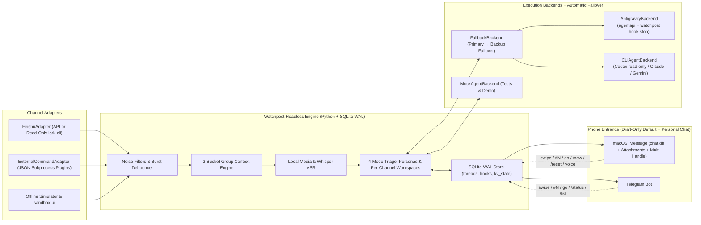

# Watchpost Architecture

Watchpost separates **ingestion**, **context/triage**, **coding-agent execution**, and **phone delivery** behind narrow Python `Protocol` contracts so every channel, agent backend, and phone entrance stays swappable without any Web UI or standalone production chat frontend.

## System Topology

## Module Map (`v0.3.0`)

- `src/watchpost/config.py`: Pydantic v2 configuration schema (`WatchpostConfig`, `BackendConfig`, `FeishuConfig`, `TelegramConfig`, `IMessageConfig`, `ExternalAdapterConfig`, `WhisperConfig`), `${ENV_VAR}` expansion, env fallbacks, `persona_file` loading, and `0600` JSON persistence.
- `src/watchpost/models.py`: Pydantic v2 domain models (`ChannelConfig` with `workspace_dir`/`persona_file`, `EngineConfig` with personal direct-chat settings, `NormalizedMessage`, `GroupContext`, `ThreadRecord`, `ThreadEvent`, `AgentResult`, `OwnerAction`).
- `src/watchpost/ports.py`: `Protocol` interfaces (`ChannelAdapter`, `AgentBackend`, `NotifierAdapter`, `MediaProcessor`).
- `src/watchpost/store.py`: Atomic **SQLite WAL** persistence across `channels`, `messages`, `threads`, `thread_events`, `outbound_bindings`, `tracked_backend_refs`, `backend_completions` (with consecutive digest dedup), and `kv_state`.
- `src/watchpost/adapters/feishu.py`: Strictly read-only Feishu adapter supporting `tenant`, `user`, and local `lark_cli` auth modes, `<at>` mention parsing, recall filtering, paginated chat discovery, and media download.
- `src/watchpost/adapters/external_plugin.py`: `ExternalCommandAdapter` running out-of-process JSON stdin/stdout plugins (`list-chats`, `fetch-recent`, `fetch-by-ids`, `download-media`).
- `src/watchpost/backends/antigravity.py`: Async `AntigravityBackend` launching/steering conversations via `agentapi`, parsing JSONL transcripts via `extract_latest_assistant_response` + `handle_stop_hook_payload`, and awaiting SQLite `backend_completions`.
- `src/watchpost/backends/fallback.py`: `FallbackBackend` wrapping primary + backup `AgentBackend` with provider-prefixed thread refs (`antigravity:...` / `codex:...`), transparent `start_thread` failover, and `steer_thread` recovery.
- `src/watchpost/backends/cli_agent.py`: Async CLI subprocess wrapper (`CLIAgentBackend`) with explicit/read-only `codex_sandbox` support.
- `src/watchpost/notifiers/imessage.py` & `telegram.py`: Owner-locked phone entrances; iMessage supports multi-handle phone/email normalization (`allowed_handles`), reaction/system/retracted filtering, non-sticker image/audio attachment extraction, `attributedBody` decoding, and echo suppression.
- `src/watchpost/engine.py` & `daemon.py`: Orchestrator (`WatchpostEngine`), rich owner commands (`#N`, `go`, `/status`, `/list`, `/help`, `/new`, `/reset`, Whisper attachment transcription, TTL-managed Personal Direct Chat), continuous daemon with optional localhost `api_port`, and comprehensive `run_doctor`.
- `src/watchpost/cli.py`: CLI commands (`init`, `init-config`, `run [--api-port]`, `hook-stop`, `doctor`, `channels [add --workspace]`, `telegram-whoami`, `install-skill`, `sandbox`, `sandbox-send`, `sandbox-ui`, `demo`, `serve`).
- `src/watchpost/server.py`: Headless FastAPI JSON control API (`127.0.0.1:8787`, zero Web UI).

## Security & Licensing Boundaries

- **Prompt Injection Defense:** Incoming messages are wrapped explicitly as `UNTRUSTED EXTERNAL CHAT INPUT` and restricted strictly from issuing outbound channel sends.
- **Draft-Only By Default:** External messaging write tokens are never required; suggested drafts stay isolated until the owner copies or approves them.
- **Zero Egress By Architecture:** Media, voice audio, repos, and local logs remain on the owner's machine.
- **License Isolation (`Apache-2.0` Core vs. External Copyleft Bridges):** Watchpost core (`Apache-2.0`) only integrates official APIs, local CLIs, and narrow JSON subprocess protocols. Copyleft desktop bridges stay strictly out-of-process and are never imported into Watchpost.
